# Attendance Bot

Marks attendance for a whole class at once. **You only type the OTP.**

## Use the website (easiest)

Open **https://mark-attendance-ug26.vercel.app**

1. Upload your student list (Excel, CSV, or paste it). It is remembered on your device.
2. Type the OTP and press **Run**.
3. Each student shows **OK** or **FAIL**. Press **Retry failed** to resend only the failed ones.

## How to add your students

Pick **any one** of these three ways:

### Way 1 — Excel (.xlsx) or CSV
1. In Excel, type **Name** and **UG Number** in the first row (optional, but good).
2. Type one student per row: name in one column, number in the next.
3. Save, then drop the file on the website. (A **CSV** is a simple version of the same table: *Save As → CSV*.)

### Way 2 — Text file (.txt)
In Notepad, one student per line, like `Rohan Mehta 41923`. Save as `.txt` and drop it on the page.

### Way 3 — Paste
Open **"Or paste the list instead"** on the page, paste your lines, press **Add pasted list**.

### What works and what doesn't

- **UG number = only the number** (`41923`). The site adds `UG/26/` itself.
- **Name first or number first, both work.** Keep each student on one row/line.
- **Mistakes are skipped, not guessed.** Typos (letter `I` instead of `1`, letter `O` instead of `0`), blank rows and duplicates appear as warnings under the list.
- If your sheet has other number columns (Sl. No, phone), add a **UG Number** heading so the right column is used.
- **Excel: only the first sheet is read.**
- **Check the list** shown after you add students, before pressing Run.
- Adding again **adds** to the list. Use **×** to remove one student, **Clear list** to start over.
- The list is saved **on that device and browser only**. On another device, add it again.

## Run it on your own computer (optional)

Same website, running on your machine instead of the hosted one.

1. Install [Node.js](https://nodejs.org) (the big green **LTS** button).
2. Download this project (**Code → Download ZIP**) and extract it.
3. Double-click `start.bat`. Your browser opens the page. (On Mac/Linux: run `node server.js`, then open http://localhost:3000.)
4. Use it exactly like the website. Close the black window to stop.

## What's in this project

| File | What it is |
|---|---|
| `web/` | The page you see (`web/guide/` has the pictures) |
| `api/submit.js` | Sends each attendance request (used by the website and by `server.js`) |
| `server.js`, `start.bat` | Runs it on your own computer |
| `students.xlsx` | Sample student list |
